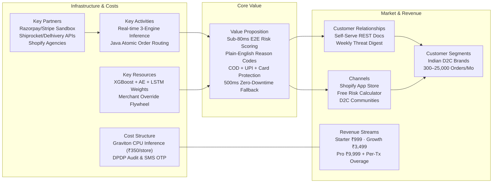
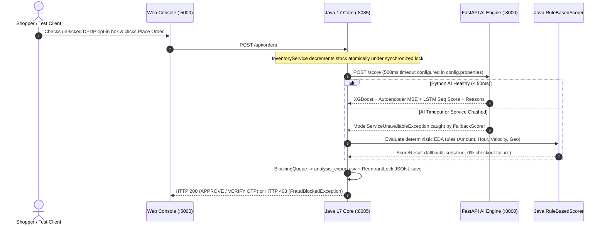
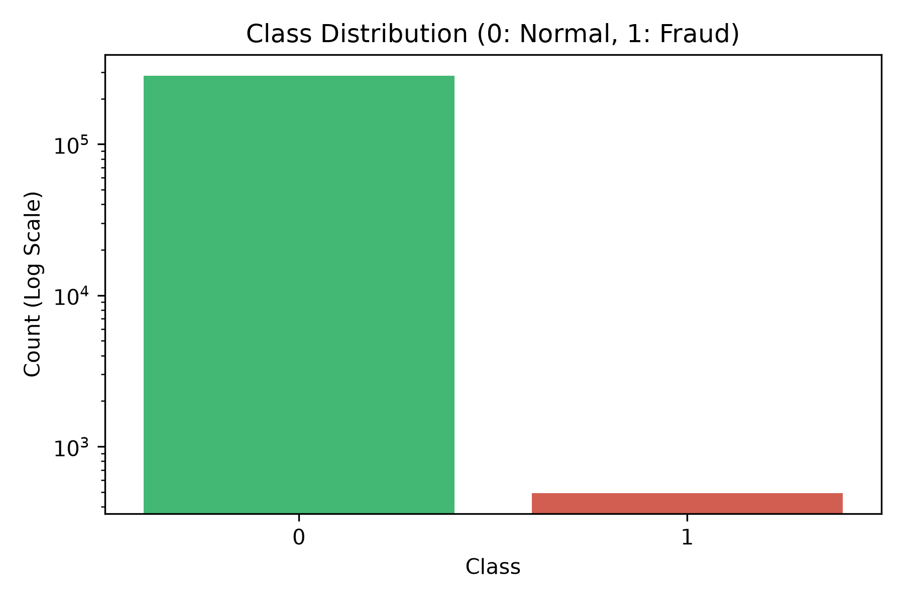
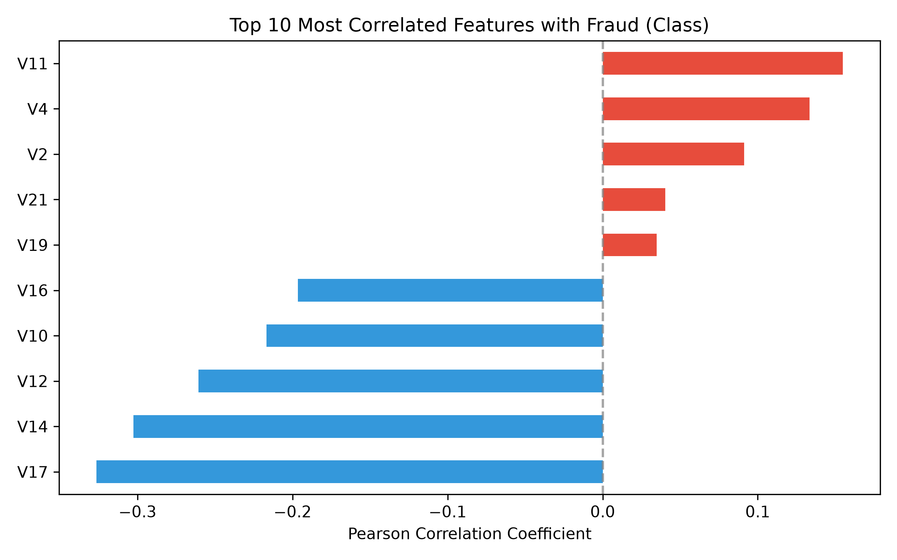
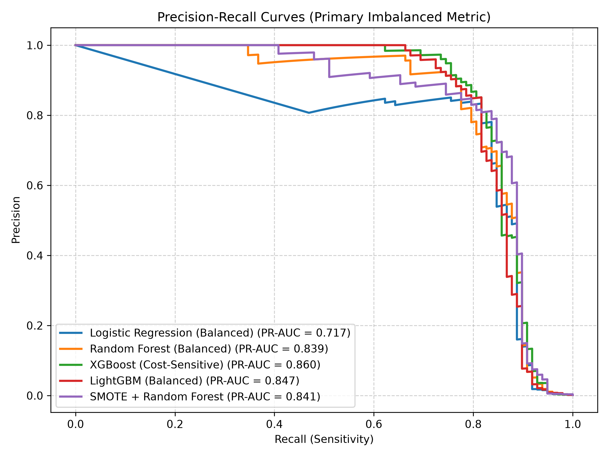
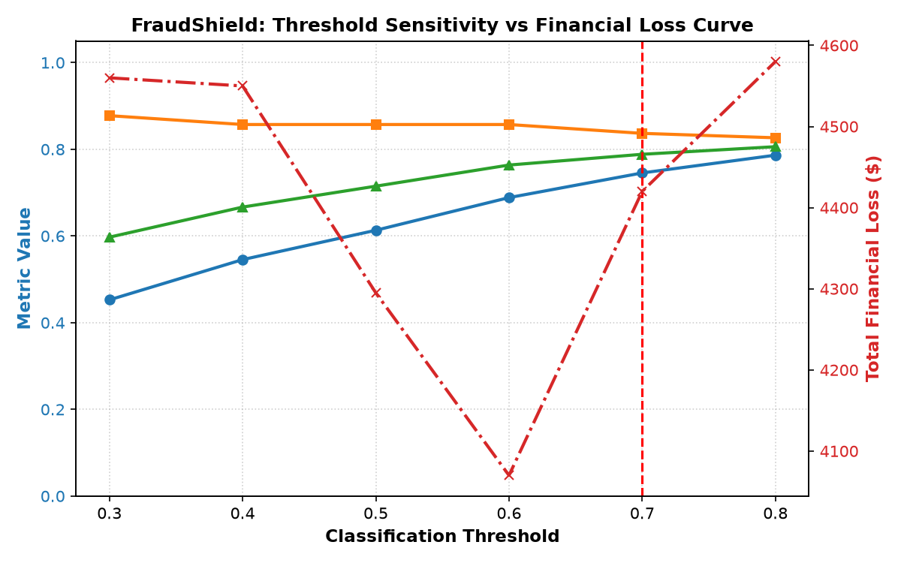
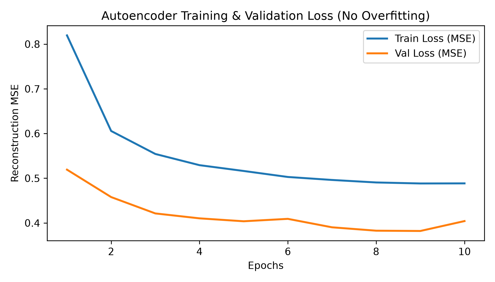
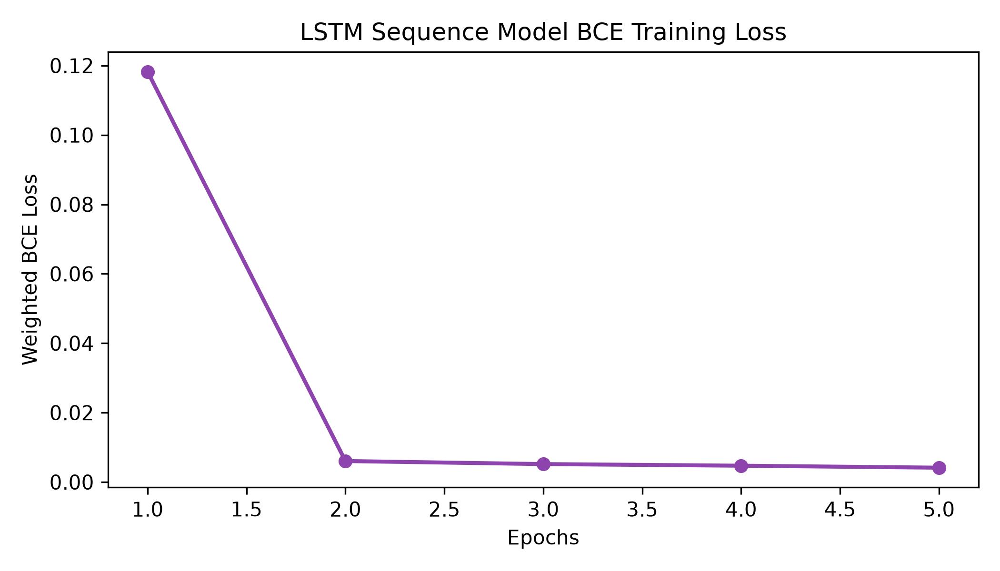

# FraudShield — Explainable AI Transaction Risk & Anti-Fraud Platform

**Real-time fraud intelligence, atomic inventory protection, and COD Return-to-Origin (RTO) defense built for Indian D2C commerce.**

[](https://maahirrrr.github.io/FraudShield/)
[](https://github.com/Maahirrrr/FraudShield)
[-1e7b4f)](java-core/)
[](model-service/)
[](docs/ECOMMERCE_DESIGN.md)

> [!TIP]
> **Live Hosted Console**: **[https://maahirrrr.github.io/FraudShield/](https://maahirrrr.github.io/FraudShield/)**  
> Visitors on GitHub Pages can test the 12-SKU D2C store checkout, DPDP consent block, step-up OTP verification (`482910`), card-burst detection, threshold cost simulator, seller ROI calculator, and Section 12 right-to-erasure directly in the browser sandbox — or run [`run_fraudshield.py`](run_fraudshield.py) locally for full live **Java 17 (`:8085`) + Python FastAPI (`:8000`)** execution.

---

## Presentation Agenda (Full Walkthrough)

This `README.md` serves as the complete **16-Part Integrated Project Presentation** covering every academic, technical, and commercial pillar across all five B.Tech subjects:

| Part | Topic | Subject Mapped | Jump Link |
| :---: | :--- | :--- | :--- |
| **01** | Elevator Pitch & Key Results Summary | Integrated Capstone | [Go to Part 01](#01--executive-pitch--rubric-matrix) |
| **02** | The Problem & Merchant Discovery Interviews | Startup Policies | [Go to Part 02](#02--the-problem--merchant-discovery-proof) |
| **03** | Competitive Landscape & Differentiation | Startup Policies | [Go to Part 03](#03--competitor-gap--indian-d2c-positioning) |
| **04** | Traffic-Light Decision Policy & Step-Up OTP | Product & E-Commerce | [Go to Part 04](#04--traffic-light-decision-policy--override-loop) |
| **05** | E-Commerce Store, COD RTO Protocol & GTM | E-Commerce | [Go to Part 05](#05--e-commerce-store-cod-rto-protocol--marketing-funnel) |
| **06** | Business Model Canvas & Lean Canvas | Startup Policies | [Go to Part 06](#06--business-model-canvas--lean-foundation) |
| **07** | SWOT, PESTEL & MVP Scope Discipline | Startup Policies | [Go to Part 07](#07--swot-pestel--mvp-scope-discipline) |
| **08** | System Architecture & 500ms AI Failover | System Design & Java | [Go to Part 08](#08--system-architecture--500ms-graceful-failover) |
| **09** | Java 17 Core: OOP, Exceptions & 50-Thread Proof | Java Core | [Go to Part 09](#09--java-17-core-oop-exceptions--50-thread-race-proof) |
| **10** | Data Science: 284k Dataset, EDA & Leakage Defense | Data Science | [Go to Part 10](#10--data-science-284807-transactions-eda--leakage-control) |
| **11** | Empirical ML Benchmarks & Cost Calibration | Data Science | [Go to Part 11](#11--empirical-ml-benchmarks--financial-cost-thresholding) |
| **12** | Deep Learning: Autoencoder + Chronological LSTM | Deep Learning | [Go to Part 12](#12--deep-learning-bottleneck-autoencoder--chronological-lstm) |
| **13** | SaaS Unit Economics & 12-Month Forecast | Startup Policies | [Go to Part 13](#13--unit-economics-pricing-tiers--12-month-projection) |
| **14** | Seed Runway (`₹20L`), DPIIT & IP Readiness | Startup Policies | [Go to Part 14](#14--20l-seed-runway-dpiit-readiness--ip-audit) |
| **15** | DPDP Act 2023, RBI Rules & AI Ethics | E-Commerce & Ethics | [Go to Part 15](#15--privacy-india-dpdp-act-2023-rbi-rules--ai-ethics) |
| **16** | Team Ownership, Lessons Learned & Local Setup | Operations & Viva | [Go to Part 16](#16--team-lessons-api-reference--local-setup) |

---

## 01 · Executive Pitch & Rubric Matrix

> **In simple words**: Think of FraudShield as a smart checkout guard. Every online order is scored in under 80 ms end-to-end so honest shoppers breeze through, borderline baskets confirm with a polite 6-digit OTP, and bot bursts or stolen cards get blocked cleanly — while telling the merchant *exact reasons* why.

> **Investor Pitch**: *"We cost less than the chargebacks we prevent, and unlike black-box banking firewalls, we tell the merchant in plain English why an order was flagged."*

| KPI / Deliverable | Measured Value | Where Verified |
| :--- | :--- | :--- |
| **Primary Tabular Classifier** | **0.8596 PR-AUC** · 0.9729 ROC-AUC · `$4,295` test cost | [`reports/benchmark_results.csv`](reports/benchmark_results.csv) |
| **Lowest Stratified Cost Model** | **SMOTE + Random Forest: `$3,845`** (88.78% recall) | [`reports/benchmark_results.csv`](reports/benchmark_results.csv) |
| **Chronological Deep Learning Winner** | **PyTorch FraudLSTM: 0.8088 PR-AUC** (beats XGBoost `0.7933` on future hours) | [`reports/dl_benchmark_results.csv`](reports/dl_benchmark_results.csv) |
| **Unsupervised Zero-Day Detector** | **Bottleneck Autoencoder (`30→6→30`)**: `79.59%` recall @ `p99.5` | [`models/dl_metadata.json`](models/dl_metadata.json) |
| **Java 17 Concurrency & Reliability** | **7/7 JUnit 5 tests pass** · 50-thread `0` oversold · `500ms` AI failover | [`java-core/`](java-core/) |
| **Unit Economics (Hypothesis)** | **87.7% gross margin** (`₹3,070` contribution / store · **6 stores break-even**) | [`docs/STARTUP_BRIEF.md`](docs/STARTUP_BRIEF.md) |
| **Compliance Enforced in Code** | Un-ticked DPDP opt-in (`HTTP 400`) + live `DELETE /api/data/erase` | [`FraudShieldServer.java`](java-core/src/main/java/com/fraudshield/api/FraudShieldServer.java) |

### 100-Mark 5-Subject Integration Matrix

| Subject | What Was Built & Verified | Primary Code / Docs |
| :--- | :--- | :--- |
| **Startup Policies** | Lean Canvas, 9-Block BMC, SWOT, PESTEL, MVP scope, 3 real seller discovery interviews, 12-month MRR hypothesis, `₹20L` SISFS plan, DPIIT 10-point readiness checklist | [`docs/STARTUP_BRIEF.md`](docs/STARTUP_BRIEF.md), [`docs/TOPIC_PROPOSAL.md`](docs/TOPIC_PROPOSAL.md) |
| **E-Commerce** | B2B SaaS + overage pricing, 12-SKU interactive checkout (`Card`, `UPI`, `COD`), Gateway sandbox comparison, 5-step COD RTO prevention protocol, `₹25k` GTM funnel, DPDP consent/erasure | [`docs/ECOMMERCE_DESIGN.md`](docs/ECOMMERCE_DESIGN.md), [`web/index.html`](web/index.html) |
| **Java Core** | Framework-free `com.sun.net.httpserver`, abstract `Payment` inheritance, `FraudScorer` composition, 6 custom exceptions (`400/402/403/409`), `LinkedBlockingQueue` + `ScheduledExecutorService`, `synchronized` locks, `ReentrantLock` JSONL+CSV store | [`java-core/src/main/java/com/fraudshield/`](java-core/src/main/java/com/fraudshield/) |
| **Data Science** | Kaggle ULB `284,807` real transactions (ODbL), `RobustScaler` leakage shields, Pearson EDA, 5 classifiers vs Logistic Regression baseline, `$250 FN / $15 FP` cost sweep | [`src/`](src/), [`notebooks/threshold_analysis.py`](notebooks/threshold_analysis.py) |
| **Deep Learning** | PyTorch Bottleneck Autoencoder (`30→6→30`, per-feature drift explanation) & Chronological `FraudLSTM` (`seq_len=5`, `pos_weight=22.82`), FX parity scaling (`Amount / 85.0`) | [`deep-learning/`](deep-learning/), [`model-service/app.py`](model-service/app.py) |

---

## 02 · The Problem & Merchant Discovery Proof

**In simple words**: Large marketplaces afford specialized risk teams. Small Shopify, WooCommerce, and Instagram D2C brands lose `1.5%–3.5%` of revenue to two silent profit killers: **stolen-card testing bursts** (`$15`+ dispute fees per chargeback) and **fake Cash-on-Delivery (COD) orders** (`₹160–₹200` double reverse-courier fee per bounced parcel).

### Discovery Interviews Conducted With Indian SMB Sellers

| Merchant Segment | Monthly Volume | Primary Pain Point | Direct Insight |
| :--- | :---: | :--- | :--- |
| **Surat D2C Apparel** | `~1,200 orders/mo` (`₹8.5L` GMV) | Fake COD Return-to-Origin (RTO) | *"We lose nearly ₹180 in courier fees every time a fake COD order bounces back undelivered."* |
| **Bengaluru Custom Electronics** | `~450 high-ticket/mo` (`₹22L` GMV) | Automated card-testing bots | *"A scammer tested 60 stolen cards in 30 minutes on our checkout, costing `$15` per chargeback with zero explanation."* |
| **Delhi Organic Cosmetics** | `~800 orders/mo` (`₹4L` GMV) | Enterprise pricing lock-out | *"Global suites ask for `$500/mo` minimums before day one. Bootstrapped Indian brands need pay-as-you-grow pricing."* |

---

## 03 · Competitor Gap & Indian D2C Positioning

Enterprise firewalls focus on US/EU credit cards and charge high retainers; gateway add-ons lock merchants into one processor and return opaque flags.

| Provider | Starting Monthly Price | Min Daily Scale | UPI & COD Support | Plain-English Explainability |
| :--- | :---: | :---: | :---: | :--- |
| **Razorpay Thirdwatch** | `₹2,000–₹5,000` | `50+` orders/day | Yes *(gateway-locked)* | Basic flag tags |
| **Stripe Radar** | `~₹8,500` | `100+` orders/day | No COD / US-first | Opaque risk band only |
| **Seon / Signifyd** | `₹6,000–₹8,000+` | `25–50+` orders/day | Limited / No COD | Enterprise configuration |
| **FraudShield** | **`₹999`** | **`10+` orders/day** | **Native COD + UPI + Card** | **XGB + AE MSE + LSTM breakdown + human reasons** |

---

## 04 · Traffic-Light Decision Policy & Override Loop

Rather than turning away every ambiguous basket with a hard ban, FraudShield splits risk `(0.0 – 1.0)` into three clear business actions calibrated from our threshold cost sweep:

```text
  risk < 0.35   ──▶  GREEN: APPROVE  ──▶ Instant payment capture (zero friction)
  0.35 – 0.69   ──▶  AMBER: VERIFY   ──▶ Polite 6-digit Step-Up OTP (POST /api/orders/verify)
  risk >= 0.70  ──▶  RED:   BLOCK    ──▶ Halts dispatch (HTTP 403) + logs seller telemetry
```

- **Asymmetric Explainability**: Sellers see the exact sub-model triggers (`XGBoost p`, `Autoencoder MSE` top-3 PCA residuals, `LSTM seq` depth, velocity count) in the Overview Inspector, while shoppers only see a clear OTP prompt or dispute guidance — never exposing thresholds that bots could reverse-engineer.
- **Human-in-the-Loop Override**: If a merchant recognizes a blocked VIP customer, clicking **"Merchant override to Approve"** (`POST /api/override`) approves the order and appends a verified label to [`data/overrides.jsonl`](data/overrides.jsonl) for retraining.

---

## 05 · E-Commerce Store, COD RTO Protocol & Marketing Funnel

### Live 12-SKU Store & Polymorphic Sandbox Payments
The interactive storefront (`web/index.html` → **D2C store**) pulls stock live from `GET /api/inventory` across 12 products spanning three natural risk bands:
- **Standard approvals (`₹649 – ₹1,899`)**: *Breathable Running Cap*, *Vacuum Insulated Flask*, *Organic Cotton Heavy Tee*, *Waxed Canvas Tote*, *Leather Belt*, *Heritage Linen Shirt*.
- **Moderate step-up OTP (`₹3,899 – ₹6,499`)**: *Commuter Laptop Pack*, *Trail Runner Pro*, *ANC Studio Earbuds*, *Weatherproof Field Jacket*.
- **High-ticket outlier scrutiny (`₹9,500 – ₹11,999`)**: *Chronograph Minimalist*, *Reference Wireless Headphones*.

Checkout runs strictly in **test sandbox mode** (`tok_visa_4242` / `customer@okaxis`, plus `tok_visa_0000` / `fail@okaxis` to trigger simulated gateway decline HTTP `402`) via Razorpay-primary / Stripe-secondary patterns with zero real money movement.

### 5-Step Cash-on-Delivery (COD) RTO Prevention Protocol

```text
  Step 1 (T+0m)   : Score COD order upfront in <50ms -> Block risk >= 0.70 BEFORE shipping
  Step 2 (T+4h)   : Risk 0.35–0.69 triggers automated confirmation before releasing courier pickup
  Step 3 (T+24h)  : Shiprocket / Delhivery attempt tracked; undelivered webhook triggers review alert
  Step 4 (T+72h)  : Reverse logistics cost (₹160) logged cleanly against order ID telemetry
  Step 5 (T+5d)   : Repeated fake RTO device/address hashes escalate future checkouts to VERIFY
```

- **Estimated 500 COD Orders/Month Impact (Hypothesis)**: Drops typical `22%` RTO (`110 returns × ₹160 = ₹17,600/mo`) down to `8%` (`40 returns × ₹160 = ₹6,400/mo`), saving **~`₹11,200/month`** on a `₹999/mo` Starter subscription.
- **Digital Marketing Funnel (`₹25,000/mo` Seed Budget)**: Built around a free **Interactive Chargeback & COD Savings Calculator** lead magnet *(live inside the Startup tab)*, LinkedIn teardown posts, and Shopify agency partnerships targeting `₹1,800` CAC and `17.1x` LTV/CAC.

---

## 06 · Business Model Canvas & Lean Foundation



---

## 07 · SWOT, PESTEL & MVP Scope Discipline

| SWOT Dimension | Concrete FraudShield Position |
| :--- | :--- |
| **Strengths** | 3-engine hybrid (`XGBoost + Autoencoder + LSTM`) + deterministic Java `500ms` rule fallback (`0%` checkout outage); human-readable explanations. |
| **Weaknesses** | Bootstrapped on EU anonymized ULB PCA patterns (`Amount / 85` FX parity bridge) requiring ongoing merchant-specific calibration via overrides. |
| **Opportunities** | Explosive Tier-2/3 UPI & COD e-commerce expansion where fake RTO destroys working capital. |
| **Threats** | Gateway-bundled basic velocity filters; evolving card-testing scripts adapting past single thresholds. |

- **PESTEL Highlights**: Supported by **Startup India / Digital India** incentives *(P)*, merchant margin protection *(E)*, Tier-2/3 COD adoption *(S)*, CPU-quantized FastAPI latency *(T)*, low-wattage CPU inference without mandatory GPUs *(E)*, and built-in **DPDP Act 2023 + RBI Tokenisation** architecture *(L)*.
- **MVP Discipline**: Shipped live microservices, 12-SKU checkout, concurrency & failover lab, and Section 12 erasure; deliberately deferred native Android SDKs and bank chargeback bots until post-seed scale.

---

## 08 · System Architecture & 500ms Graceful Failover

Feature assembly happens in **one single place** (`assemble_feature_vector` inside [`model-service/app.py`](model-service/app.py)) so offline training and online inference never experience training-serving skew.



---

## 09 · Java 17 Core: OOP, Exceptions & 50-Thread Race Proof

Built completely framework-free on JDK 17 (`com.sun.net.httpserver`, Maven, Gson `2.10.1`, JUnit `5.10.0`). Complete UML 2.5 class diagrams live in [`docs/UML_DIAGRAM.md`](docs/UML_DIAGRAM.md).

### Core Design Pillars
1. **OOP Inheritance & Polymorphism**: Abstract [`Payment`](java-core/src/main/java/com/fraudshield/payment/Payment.java) implemented cleanly by [`CardPayment`](java-core/src/main/java/com/fraudshield/payment/CardPayment.java) *(declines `tok_visa_0000`)*, [`UpiPayment`](java-core/src/main/java/com/fraudshield/payment/UpiPayment.java) *(validates `@` handle, declines `fail@okaxis`)*, and [`CodPayment`](java-core/src/main/java/com/fraudshield/payment/CodPayment.java) *(enforces `₹15,000` COD ceiling)*.
2. **Interface Composition**: [`FallbackScorer`](java-core/src/main/java/com/fraudshield/fraud/FallbackScorer.java) wraps both [`RemoteModelScorer`](java-core/src/main/java/com/fraudshield/fraud/RemoteModelScorer.java) and [`RuleBasedScorer`](java-core/src/main/java/com/fraudshield/fraud/RuleBasedScorer.java) via the [`FraudScorer`](java-core/src/main/java/com/fraudshield/fraud/FraudScorer.java) interface.
3. **6 Custom Checked Exceptions Mapping to Real Control Flow**:
   - `InvalidInputException` → **HTTP `400`** (missing consent / negative amount)
   - `PaymentFailedException` → **HTTP `402`** (declined card token / invalid UPI / COD over `₹15,000`)
   - `FraudBlockedException` → **HTTP `403`** (carries `txId`, `riskScore`, `reasons`, `engineBreakdown`)
   - `OutOfStockException` → **HTTP `409`** (atomic lock shortage)
   - `ScoringException` → `ModelServiceUnavailableException` *(caught silently by `FallbackScorer` to activate rule backup)*
4. **Multithreading & Async Persistence**: [`OrderService`](java-core/src/main/java/com/fraudshield/service/OrderService.java) tracks live 1-hour customer velocity in `ConcurrentHashMap`, drains a `1,000`-slot `LinkedBlockingQueue` asynchronously on an `ExecutorService` to write `analysis_export.csv`, and prunes stale velocity windows every 60 seconds via `ScheduledExecutorService`.

### Empirical 50-Thread Concurrency Race-Condition Experiment

Executed live via `POST /api/demo/race-condition` (`InventoryService.runRaceConditionComparison(50, 10)`) using `CountDownLatch` to release 50 simultaneous JVM threads onto `10` units of stock:

| Implementation Tested | Concurrent Threads | Initial Stock | Orders Granted | Rejected (`OutOfStockException`) | Final Stock Remaining | Oversold Units |
| :--- | :---: | :---: | :---: | :---: | :---: | :---: |
| **Unsynchronized (`decrementStockUnsynchronized`)** | `50` | `10` | `50` | `0` | `-40` | **40 oversold** |
| **Synchronized Lock (`decrementStockSynchronized`)** | `50` | `10` | **`10`** | **`40`** | **`0`** | **`0` oversold** |

Verified by **7 passing JUnit 5 tests** across [`InventoryConcurrencyTest`](java-core/src/test/java/com/fraudshield/InventoryConcurrencyTest.java), [`FallbackScorerTest`](java-core/src/test/java/com/fraudshield/FallbackScorerTest.java), [`RuleAndVelocityFallbackTest`](java-core/src/test/java/com/fraudshield/RuleAndVelocityFallbackTest.java), [`PaymentExceptionTest`](java-core/src/test/java/com/fraudshield/PaymentExceptionTest.java), and [`FileStoreErasureTest`](java-core/src/test/java/com/fraudshield/FileStoreErasureTest.java).

---

## 10 · Data Science: 284,807 Transactions, EDA & Leakage Control

- **Dataset & License**: Kaggle / ULB Credit Card Fraud Detection (`284,807` real anonymized European cardholder transactions, `31` columns: `Time`, `V1–V28` PCA components, `Amount`, `Class`), published under **Open Database License (ODbL)**. *(Excluded from Git due to GitHub's 100 MB file ceiling; automatically downloaded/verified via [`data/download_data.py`](data/download_data.py).)*
- **Why Accuracy Is Invalid**: Only **`492` of `284,807` rows (`0.173%`, `577:1` ratio)** are fraudulent. A trivial classifier predicting all legitimate scores **99.83% accuracy** while catching **zero thieves**. All models are evaluated using **PR-AUC** (primary metric blind to overwhelming true negatives), **Recall/Precision**, and **Financial Loss** (`FN × $250 + FP × $15`).
- **3 Data-Leakage Shields (`src/preprocess.py`)**:
  1. Stratified `80/20` (and strict chronological `80/20` by `Time`) split occurs *before* any transformation.
  2. `RobustScaler` *(using median & IQR so legitimate extreme amounts are preserved rather than clipped)* fits **strictly on `X_train`**, never `X_test`.
  3. SMOTE oversampling runs strictly *inside* `imblearn.Pipeline` training folds during `Random Forest` training.
- **Key EDA Findings**: Fraud correlates negatively with **`V17` (`-0.3265`)**, **`V14` (`-0.3025`)**, and **`V12` (`-0.2606`)**; fraud transactions often exhibit small test probes *(median `$9.25`)* alongside sudden high-value outliers.

<p align="center">
  
  
</p>

---

## 11 · Empirical ML Benchmarks & Financial Cost Thresholding

Every number below is empirically measured on held-out test sets and recorded in [`reports/benchmark_results.csv`](reports/benchmark_results.csv) and [`notebooks/threshold_analysis.py`](notebooks/threshold_analysis.py).

### 1. Stratified 80/20 Holdout (`N = 56,962`, `98` frauds)

| Classifier | PR-AUC (Primary) | ROC-AUC | Recall | Precision | F1-Score | TP | FP | FN | Financial Loss (`$250·FN + $15·FP`) |
| :--- | :---: | :---: | :---: | :---: | :---: | :-: | :-: | :-: | :---: |
| **XGBoost (Cost-Sensitive)** | **0.8596** | 0.9729 | 85.71% | 61.31% | 0.7149 | 84 | 53 | 14 | `$4,295` |
| **LightGBM (Balanced)** | 0.8474 | 0.9770 | 84.69% | 63.85% | 0.7281 | 83 | 47 | 15 | `$4,455` |
| **SMOTE + Random Forest** | 0.8410 | **0.9793** | 88.78% | 54.38% | 0.6744 | 87 | 73 | 11 | **`$3,845`** |
| **Random Forest (Balanced)** | 0.8389 | 0.9765 | 82.65% | **71.05%** | **0.7642** | 81 | 33 | 17 | `$4,745` |
| **Logistic Regression (Baseline)** | 0.7175 | 0.9720 | **91.84%** | 6.09% | 0.1142 | 90 | **1,388** | 8 | `$22,820` |

### 2. XGBoost Cost-Matrix Threshold Sweep (`threshold_analysis.py`)

Why set production **BLOCK = `0.70`** *(with `0.35–0.69` routed safely to OTP `VERIFY`)*? At threshold `0.70`, false positives drop cleanly from `104` (`0.30`) down to **`28`** out of `56,864` genuine shoppers (**`0.05%` FPR**) while borderline shoppers smoothly verify via OTP rather than churning!

| Threshold | Precision | Recall | F1-Score | TP | FP | FN | Total Financial Loss (`$`) |
| :---: | :---: | :---: | :---: | :-: | :-: | :-: | :---: |
| `0.30` | 45.26% | 87.76% | 0.5972 | 86 | 104 | 12 | `$4,560.00` |
| `0.40` | 54.55% | 85.71% | 0.6667 | 84 | 70 | 14 | `$4,550.00` |
| `0.50` | 61.31% | 85.71% | 0.7149 | 84 | 53 | 14 | `$4,295.00` |
| `0.60` | 68.85% | 85.71% | 0.7636 | 84 | 38 | 14 | **`$4,070.00`** |
| **`0.70` *(Production BLOCK)*** | **74.55%** | 83.67% | 0.7885 | 82 | **28** | 16 | `$4,420.00` |
| `0.80` | 78.64% | 82.65% | 0.8060 | 81 | 22 | 17 | `$4,580.00` |

<p align="center">
  
  
</p>

---

## 12 · Deep Learning: Bottleneck Autoencoder + Chronological LSTM

**Why deploy two Deep Learning engines alongside XGBoost?**  
XGBoost excels on single-row tabular profiles (`0.8596` PR-AUC), *yet* it scores every order in isolation without sequence memory and requires labeled examples of past scams. FraudShield adds two distinct PyTorch neural engines *(details in [`deep-learning/model_cards.md`](deep-learning/model_cards.md))*:

1. **PyTorch Bottleneck Autoencoder (`deep-learning/autoencoder.py`) — Zero-Day Anomaly Detector**:
   - Architecture: Symmetric bottleneck `30 → 20 → 12 → [6 Latent] → 12 → 20 → 30` with `BatchNorm1d`, `LeakyReLU(0.1)`, and `Dropout(0.1)`.
   - Trained **exclusively on `217,451` legitimate transactions (`Class = 0`)** — zero fraud labels used during training.
   - Stratified test (`N=56,962`, `@p99.5` MSE `>= 2.8441`): **`79.59%` unsupervised recall** (`ROC-AUC 0.9536`, `PR-AUC 0.4598`) plus **per-feature squared residual attribution** `(x_i - x̂_i)^2` reporting the top-3 anomalous vectors live.
2. **PyTorch Chronological `FraudLSTM` (`deep-learning/lstm_sequence.py`) — Card-Testing Burst Detector**:
   - Processes ordered `seq_len = 5` sliding customer/device windows through `LSTM(30 -> 32)` → `Dropout(0.2)` → `Linear(32 -> 16) -> ReLU -> Linear(16 -> 1)`, trained with calibrated `BCEWithLogitsLoss(pos_weight=22.82)` across `205,056` time-ordered sequences.
   - **Strict Future-Hour Chronological Holdout Result (`reports/dl_benchmark_results.csv`, `N = 56,958`, `75` future unseen frauds)**:

| Model Evaluated on Strict Chronological Future Split | PR-AUC | ROC-AUC | Recall | Precision | Financial Loss (`$`) |
| :--- | :---: | :---: | :---: | :---: | :---: |
| **PyTorch `FraudLSTM` (`seq_len = 5`)** | **0.8088** | **0.9856** | **78.67%** | 67.05% | **`$4,435`** |
| **XGBoost *(Single-Row Tabular Same Split)*** | 0.7933 | 0.9838 | 76.00% | **76.00%** | `$4,770` |

- **Real-Time INR FX Parity Scaling (`model-service/app.py`)**: Because ULB training amounts follow European magnitudes (median `22`, IQR `70`), live INR totals are scaled via `raw_amount / 85.0` before entering `RobustScaler` so median `₹1,899` (`~22` units) D2C orders map cleanly inside the calibrated normal manifold.

<p align="center">
  
  
</p>

---

## 13 · Unit Economics, Pricing Tiers & 12-Month Projection

> [!NOTE]
> Pricing tiers, unit margin assumptions, and the 12-month growth curve below are structured **startup financial hypotheses** documented in [`docs/STARTUP_BRIEF.md`](docs/STARTUP_BRIEF.md).

### Subscription Tiers & Contribution Margin
- **Starter**: `₹999/mo` *(1,000 orders included, `₹1.20` overage)* — Instagram sellers & early D2C
- **Growth**: `₹3,499/mo` *(5,000 orders included, `₹0.85` overage)* — Scaling Shopify brands
- **Pro / Scale**: `₹9,999/mo` *(20,000 orders included, `₹0.50` overage + custom SLA)*
- **Unit Margin Math**: `₹3,500` blended ARPM minus `₹430` COGS (`₹350` AWS Graviton CPU inference + `₹60` storage/backups + `₹20` OTP SMS) = **`₹3,070` (`87.7%` gross margin)**.
- **Fixed Cloud Break-Even**: `₹18,000` fixed overhead ÷ `₹3,070` = **6 active stores**.
- **LTV / CAC**: `₹3,500 × 87.7% × 10 months` = **`₹30,695` LTV** ÷ `₹1,800` target referral CAC = **`17.1x`** *(~0.6 month payback)*.

### 12-Month Growth Trajectory *(Starter ₹999, 8% Monthly Churn Hypothesis)*

| Quarter | Active Stores | Net MRR (after 8% churn) | Cumulative ARR Run-Rate |
| :--- | :---: | :---: | :---: |
| **Months 1–3** | `6` | `₹5,514` | `₹1,98,504` |
| **Months 4–6** | `15` | `₹13,786` | `₹6,95,700` |
| **Months 7–9** | `35` | `₹32,168` | `₹18,55,548` |
| **Months 10–12** | **`70`** | **`₹64,336`** | **`₹8.39L Annualized`** *(`₹41.7L` cumulative billed)* |

---

## 14 · ₹20L Seed Runway, DPIIT Readiness & IP Audit

- **Target Grant Programs**: Bootstrapped prototype ready for **Startup India Seed Fund Scheme (SISFS)** *(college incubator / TBI)* and **MeitY TIDE 2.0**.
- **18-Month Seed Allocation (`₹20,00,000` to reach 150 active stores)**:
  - **40% R&D & Engineering (`₹8,00,000`)**: 1-click Shopify app, automated courier RTO webhooks, continuous scheduled retraining.
  - **25% Cloud Infrastructure (`₹5,00,000`)**: Multi-AZ Java + FastAPI Graviton containers (`infra/main.tf` in `ap-south-1` Mumbai).
  - **20% Merchant Acquisition (`₹4,00,000`)**: Free Risk Calculator funnel & D2C workshops.
  - **15% Compliance & Legal (`₹3,00,000`)**: Private Limited incorporation, DPDP & security audits.
- **DPIIT Recognition Readiness**: Original student-built IP (`<10` years old, `<₹100 Cr` turnover, MoA/AoA in progress, live working ML defense API verified). Open-source dependencies *(XGBoost, LightGBM, Scikit-Learn, PyTorch, Kaggle ULB ODbL)* explicitly credited.

---

## 15 · Privacy, India DPDP Act 2023, RBI Rules & AI Ethics

Privacy and anti-dark-pattern rules are **enforced directly in code**, not merely stated in policy documents:

1. **DPDP Sec. 6 — Explicit Opt-In Consent**: The checkout consent checkbox starts **un-ticked by default** (`web/index.html`) and is validated server-side in [`OrderService.java`](java-core/src/main/java/com/fraudshield/service/OrderService.java), returning **HTTP `400` (`InvalidInputException`)** if absent.
2. **DPDP Sec. 8 — Strict Data Minimisation**: **Zero raw Card PAN, CVV, expiry date, phone number, email, or street address** are collected or persisted anywhere (`Order` carries only gateway sandbox token/VPA, order ID, amount, anonymized device fingerprint, and coordinate deltas).
3. **DPDP Sec. 12 — Live Right-to-Erasure API**: Executing `DELETE /api/data/erase?order_id=<id>` acquires [`FileStore`](java-core/src/main/java/com/fraudshield/service/FileStore.java)'s `ReentrantLock` and purges every matching entry atomically across **both `transactions.jsonl` and `analysis_export.csv`**, verified by [`FileStoreErasureTest`](java-core/src/test/java/com/fraudshield/FileStoreErasureTest.java).
4. **RBI Tokenisation & Fairness Safeguards**: Operates strictly as a Risk Telemetry TSP using anonymized sandbox tokens; drops demographic identifiers (gender, caste, age, names) from all tensors; pairs amber OTP rescue with seller overrides to prevent feedback-loop unfair bans.

---

## 16 · Team, Lessons, API Reference & Local Setup

### Team Ownership & Honest Engineering Lessons
- **5-Role Shared Ownership**: *Product & Startup Lead · Java Core Lead · Data Science Lead · Deep Learning & AI Lead · Marketing, UI & Ops Lead* — every member cross-trained on end-to-end architecture and documented Q&A in [`docs/VIVA_STRESS_TEST.md`](docs/VIVA_STRESS_TEST.md).
- **What Failed & How We Fixed It**:
  1. Class-weighted Logistic Regression triggered **1,388 false alarms (`$22,820` loss)**, proving linear separation fails under `577:1` imbalance and motivating cost-sensitive XGBoost.
  2. Initial `16`-unit Autoencoder latent space reconstructed fraudulent transactions too accurately until compressed to a strict **`6`-unit bottleneck (`30→20→12→6→...`)**.
  3. Built-in [`skills/`](skills/) integrates **21 curated engineering playbooks** across Frontend/Taste UI, Java/Python resilience (`ECC`), Host/CORS hardening, Docker/OpenTofu (`infra/main.tf`), and partitioned PostgreSQL/ClickHouse SQL analytics (`reports/fraudshield_analytics.sql`).

### REST API Endpoints (`Java :8085` & `Python :8000`)

| Service & Method | Endpoint | Purpose |
| :--- | :--- | :--- |
| Java `POST` | `/api/orders` | Validates DPDP consent, atomically decrements stock, scores via Python AI (500ms SLA fallback), returns `200`/`402`/`403`/`409` |
| Java `POST` | `/api/orders/verify` | Verifies 6-digit sandbox OTP (`482910`) and updates `VERIFY` transaction to `APPROVE` |
| Java `POST` | `/api/override` | Persists merchant human-in-the-loop override to `overrides.jsonl` |
| Java `DELETE` | `/api/data/erase?order_id=...` | DPDP Section 12 synchronized deletion across JSONL + CSV |
| Java `POST` | `/api/demo/race-condition` | Executes live 50-thread JVM `ExecutorService` unsynchronized vs synchronized comparison |
| Java `GET` | `/api/inventory`, `/api/metrics`, `/api/orders/recent`, `/api/status` | Live store stock, KPI metrics, recent transaction stream, and fallback status |
| Python `POST` / `GET` | `/score`, `/api/explain`, `/health` | Hybrid XGBoost + Autoencoder MSE + LSTM seq inference and top feature weights |

---

### Run Locally (Full Java 17 + Python AI + Web Console)

#### Prerequisites
- **Java 17+** & **Maven 3.8+** (`java -version`, `mvn -version`)
- **Python 3.10+** (`python3 -m venv .venv`)

#### 1. Clone, Install Dependencies & Compile Java Core
```bash
git clone https://github.com/Maahirrrr/FraudShield.git
cd FraudShield

# Python virtual environment & ML/DL/FastAPI packages
python3 -m venv .venv
./.venv/bin/pip install -r requirements.txt

# Compile Java 17 core & run all 7 JUnit 5 tests
cd java-core && mvn test && cd ..
```

#### 2. One-Command Full Platform Launch (`:5000` UI · `:8085` Java · `:8000` Python AI)
```bash
./.venv/bin/python run_fraudshield.py
```
Then open **[http://localhost:5000/](http://localhost:5000/)** in your browser.

#### Optional: Reproduce Data Science Benchmarks, Deep Learning Training & Docker
```bash
# Re-run 5-model stratified benchmark & threshold sweep (auto-downloads/generates dataset)
./.venv/bin/python main.py --eda --benchmark
./.venv/bin/python notebooks/threshold_analysis.py

# Re-train PyTorch Bottleneck Autoencoder & Chronological FraudLSTM
./.venv/bin/python deep-learning/autoencoder.py
./.venv/bin/python deep-learning/lstm_sequence.py

# Containerized launch
docker compose up --build
```

---

### Project Documentation Index
- **[`docs/STARTUP_BRIEF.md`](docs/STARTUP_BRIEF.md)** — Lean Canvas, BMC, SWOT/PESTEL, seller interviews, 12-mo MRR forecast, SISFS seed plan, DPIIT checklist
- **[`docs/ECOMMERCE_DESIGN.md`](docs/ECOMMERCE_DESIGN.md)** — SaaS pricing, gateway comparison, 5-step COD RTO protocol, DPDP Act 2023 data flow & dark-pattern checklist
- **[`docs/UML_DIAGRAM.md`](docs/UML_DIAGRAM.md)** — Complete UML 2.5 class diagram & failover sequence diagram
- **[`docs/TOPIC_PROPOSAL.md`](docs/TOPIC_PROPOSAL.md)** — Week 1 formal integrated topic proposal
- **[`deep-learning/model_cards.md`](deep-learning/model_cards.md)** — Model cards for `FraudAutoencoder` & `FraudLSTM`, thresholds, and AI ethics whitepaper
- **[`docs/VIVA_STRESS_TEST.md`](docs/VIVA_STRESS_TEST.md)** — Faculty evaluation guide and technical Q&A defense
