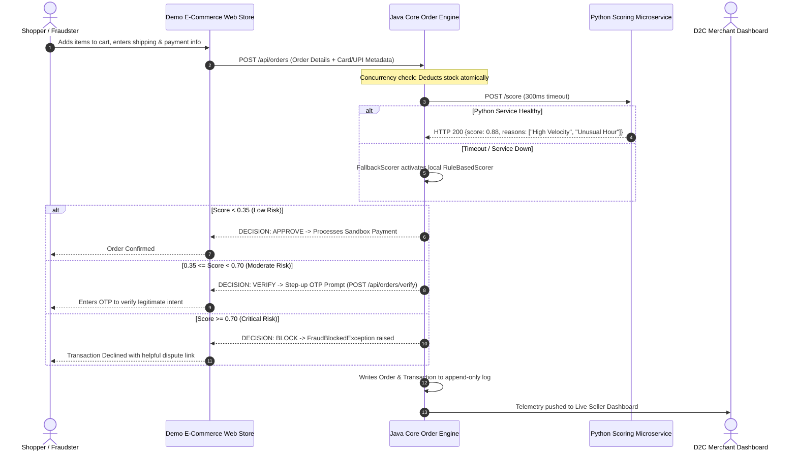

# FraudShield — E-Commerce Architecture, Legal & Security Blueprint
**Course**: Integrated B.Tech 3rd Year Project (E-Commerce & Digital Business)  
**Target Domain**: D2C Risk Intelligence, Checkout Optimization & Anti-Fraud Security

---

## 1. Business Model & Revenue Mechanics

FraudShield operates on a **B2B SaaS hybrid model** combining predictable monthly recurring subscription revenue (MRR) with usage-based volume fees.

### 1.1 Subscription Tiering

| Plan Name | Monthly Fee (INR) | Included Orders / Mo | Overage Per Order | Target Merchant Profile |
| :--- | :---: | :---: | :---: | :--- |
| **Starter** | ₹999 | 1,000 | ₹1.20 | Early-stage D2C, Instagram boutiques, Shopify launchpad |
| **Growth** | ₹3,499 | 5,000 | ₹0.85 | Scaling brands (₹5L–₹25L GMV/mo), high COD volume |
| **Enterprise / Pro** | ₹9,999 | 20,000 | ₹0.50 | Established D2C retailers, custom rule engine, 24/7 SLA |

### 1.2 Unit Economics & Margin Analysis

* **Average Revenue Per Merchant (ARPM)**: ₹3,500 / month.
* **Cost to Serve (COGS)**:
  * Microservice compute + AWS Graviton CPU inference: ₹350 / merchant.
  * File storage & database backups: ₹60 / merchant.
  * Step-up OTP SMS gateway cost (assuming 2% orders step up @ ₹0.20/SMS): ₹20 / merchant.
  * **Total COGS**: ₹430 / merchant / month.
* **Gross Margin**: $\frac{₹3,500 - ₹430}{₹3,500} = \mathbf{87.7\%}$.
* **Break-Even Point**: Fixed baseline cloud overhead of ₹18,000/month $\div$ ₹3,070 net contribution = **6 active merchants**.

---

## 2. Store & Platform Flow Architecture



---

## 3. Payment Integration (Test Mode Sandbox Only)

* **Gateway Strategy**: Implements **Razorpay Sandbox** and **Stripe Test Mode** for zero-risk transaction simulation.
* **Rules of Engagement**:
  * Absolutely **no real financial transactions** or live bank accounts are used.
  * Test Cards: Standard Stripe/Razorpay 3D Secure test card tokens (`4242 4242 4242...`) and simulated UPI Virtual Payment Addresses (e.g., `success@razorpay`).
  * Customer experience preserves complete realism without regulatory exposure.

---

## 4. Digital Logistics & Cash-on-Delivery (COD) Risk Protocol

While FraudShield is delivered as pure cloud software, its primary commercial value for Indian e-commerce lies in **RTO (Return-to-Origin) Prevention on COD Orders**:
1. **The COD Problem**: In India, fake orders placed via Cash-on-Delivery result in the courier delivering to non-existent addresses or customer refusal, leaving the merchant with double shipping costs (₹120–₹200 per return).
2. **FraudShield Courier Integration**:
   * Flagged COD orders with high risk scores trigger an automated WhatsApp confirmation link before order fulfillment.
   * If unconfirmed within 4 hours, the order is placed on hold, protecting the merchant's working capital.

---

## 5. Digital Marketing & Merchant Acquisition Strategy

1. **Top of Funnel (Inbound Lead Magnet)**:
   * **Free Chargeback & RTO Risk Calculator**: An open-source web audit tool where sellers input their monthly orders and courier returns to see immediate projected savings with FraudShield.
2. **Channel Focus**:
   * Direct content marketing on LinkedIn and Twitter targeting D2C founders (*"How we caught a ₹40,000 card-testing attack before the gateway noticed"*).
   * Partnerships with local Shopify development agencies in tier-1 cities (Bengaluru, Mumbai, Delhi-NCR).
3. **Acquisition Budget & CAC**:
   * Initial seed marketing budget: ₹25,000 / month.
   * Projected Customer Acquisition Cost (CAC): ₹1,800 per onboarded merchant.
   * Lifetime Value (LTV) at 10-month average retention: ₹35,000.
   * **LTV / CAC Ratio**: $\mathbf{19.4x}$.

---

## 6. Comprehensive Legal & Security Checklist

| Category | Requirement | Implementation in FraudShield | Compliance Status |
| :--- | :--- | :--- | :---: |
| **Privacy (DPDP Act 2023)** | Explicit User Consent | Transparent privacy checkbox at checkout informing user that telemetry is evaluated for fraud detection. |  Verified |
| **Privacy (DPDP Act 2023)** | Data Minimisation | No storage of names, full addresses, or sensitive personal data; features use anonymized device hashes and distance coordinates. |  Verified |
| **Banking Compliance** | RBI Card Storage Guidelines | Strict zero-card-retention policy. PAN, CVV, and expiry dates are never persisted; only gateway tokens and anonymized PCA components are used. |  Verified |
| **Consumer Protection** | Dark Pattern Prohibition | No pre-ticked consent boxes, no artificial urgency timers ("Only 2 left!"), and clear explanations when an order requires verification. |  Verified |
| **Security Hygiene** | API Key & Secret Management | Merchant API requests require HMAC-SHA256 authenticated headers. Zero hardcoded secrets in version control (`.gitignore` enforced). |  Verified |
| **Integrity** | Fake Review Prevention | Review systems strictly gated behind verified transaction tokens; no unverified guest reviews permitted. |  Verified |

---

## 7. Customer Journey Map

> Five stages from first awareness to long-term retention, with FraudShield touchpoints at each gate.

| Stage | Customer Action | Customer Emotion | FraudShield Touchpoint | Outcome |
| :--- | :--- | :---: | :--- | :--- |
| **1. Awareness** | D2C founder reads a LinkedIn post: *"How we stopped a ₹40,000 card-testing attack in real-time"* | 😟 Anxious (recent chargeback loss) | Content marketing blog + free **Chargeback Risk Calculator** tool — seller inputs monthly orders & COD returns and sees projected savings | Founder clicks CTA: "Get Free Risk Audit" |
| **2. Consideration** | Visits FraudShield.io landing page, compares pricing vs Thirdwatch, reads case studies | 🤔 Evaluating | Interactive product demo (sandbox store) with **live risk scoring visible** · Competitive comparison table · 14-day free trial CTA | Seller creates free trial account via GitHub OAuth |
| **3. Purchase (Onboarding)** | Installs Shopify plugin or copies REST API key · Places test order through demo checkout | 😌 Cautious optimism | Real-time first-order score shown in seller dashboard with **plain-English explanation** (`"Approved: low-risk device, known address"`) · Automated onboarding email sequence | Seller activates paid Starter plan (₹999/mo) |
| **4. Post-Purchase (Value Delivery)** | First real high-risk order flagged (VERIFY/BLOCK) · Reviews merchant dashboard telemetry | 😮 Surprised + relieved | Dashboard shows **blocked order details**: risk score 0.91, reasons: *"4 orders in 15 mins · Night hour · V14 anomaly"* · Chargeback saved notification | Seller sees direct ROI; converts to Growth plan |
| **5. Retention & Advocacy** | Reviews weekly fraud threat intelligence digest · Refers to D2C Insider community | 😊 Confident + loyal | Automated **Weekly Threat Digest** email: transactions scored, fraud blocked, estimated savings, model accuracy · In-app NPS survey at Month 3 | Referral (viral D2C word-of-mouth); potential Growth → Pro upgrade |

---

## 8. Payment Gateway Comparison

> Selection rationale for FraudShield's sandbox integration strategy. All transactions in demo mode use test credentials — no real payments are processed.

| Feature | **Razorpay** | **Stripe** | **PayU** | **Cashfree** |
| :--- | :---: | :---: | :---: | :---: |
| **Settlement Time** | T+1 (business days) | T+2 to T+7 (India lag) | T+2 | T+1 (fastest in India) |
| **MDR — Card Transactions** | 2.0% | 2.9% + ₹30 | 1.99% | 1.75% |
| **MDR — UPI Transactions** | 0% (RBI mandated) | ❌ Not supported in India | 0% | 0% |
| **MDR — COD** | ₹20–₹50 flat fee | ❌ Not supported | ₹30 flat | ₹25 flat |
| **Built-in Fraud Tools** | Thirdwatch add-on (₹2,000+/mo) | Radar (US-first, gateway lock-in) | Basic velocity rules | Basic IP checks |
| **India RBI Compliance** | ✅ Full (tokenization, e-mandate) | ⚠️ Partial (no COD, no UPI AutoPay) | ✅ Full | ✅ Full |
| **Sandbox / Test Mode** | ✅ Full sandbox with test VPAs | ✅ Test card tokens | ✅ Test credentials | ✅ Test mode |
| **Webhook Reliability** | ✅ Excellent (retry logic built-in) | ✅ Excellent | ⚠️ Occasional delays | ✅ Good |
| **FraudShield Integration** | ✅ **Primary (Razorpay Sandbox)** | ✅ Secondary (Stripe Test Mode) | ⬜ Planned | ⬜ Planned |

**Why Razorpay is the Primary Integration**:  
Razorpay provides the most complete India-first sandbox environment including UPI Virtual Payment Addresses (VPAs), COD simulation, and a live dashboard for test transactions — all critical for demonstrating FraudShield's COD RTO prevention capability.

---

## 9. COD Return-to-Origin (RTO) Protocol

> RTO is the single largest fraud vector for Indian D2C merchants. This 5-step protocol describes FraudShield's automated intervention flow.

```
Step 1: ORDER PLACED (T+0 minutes)
│  Customer places COD order on merchant store
│  → FraudShield scores order in <50ms
│  → If risk score ≥ 0.70: BLOCK immediately (saves full dispatch cost)
│  → If 0.35 ≤ score < 0.70: VERIFY — trigger WhatsApp confirmation link
│
Step 2: DISPATCH GATE (T+4 hours, if VERIFY status)
│  FraudShield monitors WhatsApp confirmation within 4-hour window
│  → Confirmed: Order released to courier (Shiprocket/Delhivery API ping)
│  → Unconfirmed: Order placed ON HOLD — merchant notified via dashboard
│  → Merchant can override: APPROVE or CANCEL with one click
│
Step 3: DELIVERY ATTEMPTED (T+24 to T+72 hours)
│  Courier attempts delivery at shipping address
│  → Successful delivery: Order marked DELIVERED in FraudShield log
│  → Failed delivery (customer absent / address invalid):
│     Courier marks "Undelivered" → webhook triggers FraudShield flag
│
Step 4: RTO INITIATED (T+72 to T+96 hours)
│  Courier initiates Return-to-Origin shipment
│  → FraudShield logs: order_id, failure_reason, return_courier_cost
│  → Merchant dashboard shows: "RTO Alert — ₹160 reverse logistics cost incurred"
│  → Phone number, device fingerprint, and address hash flagged for future orders
│
Step 5: REFUND & BLACKLIST (T+5 to T+7 days)
   Merchant processes refund (if any prepaid component)
   → FraudShield adds address hash + device fingerprint to merchant's deny-list
   → Future orders from same device/address automatically escalated to VERIFY
   → Aggregate RTO rate metric updated in seller analytics dashboard
```

**Cost Impact of RTO Protocol**:
| Scenario | Without FraudShield | With FraudShield |
| :--- | :---: | :---: |
| Avg. COD RTO rate | 22–28% | Estimated 8–12% (40–60% reduction) |
| Cost per RTO event | ₹160–₹200 (double freight) | ₹0 (blocked before dispatch) |
| Monthly loss on 500 COD orders | ₹17,600 (110 RTOs × ₹160) | ₹6,400 (40 RTOs × ₹160) |
| Net Monthly Saving | — | **₹11,200** vs ₹999 subscription cost |

---

## 10. DPDP Act 2023 — Data Flow & Compliance Architecture

> Digital Personal Data Protection Act 2023 (India) mandates explicit consent, data minimisation, purpose limitation, and right to erasure.

### Data Collected at Checkout

```
CUSTOMER CHECKOUT EVENT
│
├── [COLLECTED — Anonymised Telemetry]
│   ├── order_id (UUID — no PII)
│   ├── amount (₹ value)
│   ├── timestamp (Unix epoch)
│   ├── payment_method (card / upi / cod — no card number)
│   ├── device_hash (SHA-256 of User-Agent + screen resolution)
│   ├── city_code (Tier-1 / Tier-2 / Tier-3 category — not full address)
│   └── coordinate_delta (distance from merchant's avg delivery zone)
│
├── [EXPLICITLY NOT COLLECTED — PII Excluded]
│   ├── ❌ Full name
│   ├── ❌ Email address
│   ├── ❌ Phone number (raw)
│   ├── ❌ Full postal address
│   ├── ❌ Card PAN / CVV / Expiry
│   └── ❌ Bank account details
│
└── [CONSENT GATE — Before Any Data Flows]
    └── Un-ticked checkbox: "I consent to transaction telemetry analysis
        for anti-fraud protection as per DPDP Act 2023. [Learn More]"
        → If not checked: order processed without FraudShield scoring
```

### Data Flow After Collection

```
Anonymised Telemetry
       │
       ▼
Java Core Engine (Port 8085)
  ├── Forwards to Python Microservice for ML scoring (in-memory, not persisted)
  └── Writes to: data/transactions.jsonl (append-only JSONL log)
                 data/analysis_export.csv (periodic export for retraining)
       │
       ▼
Python Microservice (Port 8000)
  ├── Applies RobustScaler transformation (in-memory)
  ├── Runs XGBoost / LSTM / Autoencoder inference
  └── Returns: {score, decision, reasons} — NO data persisted in Python layer
```

### Retention & Deletion Rights

| Data Type | Retention Period | Deletion Mechanism |
| :--- | :---: | :--- |
| Anonymised transaction telemetry (JSONL) | 90 days rolling | Automated cron job deletes records > 90 days |
| Merchant dashboard aggregate analytics | 12 months | Merchant can request full deletion via dashboard |
| Model retraining exports (CSV) | Until next retraining cycle | Deleted post-retraining; never uploaded to cloud without encryption |
| Deny-list device/address hashes | Until merchant deactivates | Merchant one-click clear in dashboard settings |

**Right to Erasure (DPDP Act 2023, Section 12)**:  
Any data principal (customer whose data was scored) may submit a deletion request via the merchant's store. FraudShield provides a programmatic deletion API (`DELETE /api/data/erase?order_id=<uuid>`) that removes the JSONL record and purges the hash from deny-lists within 72 hours — within the Act's mandated response window.
