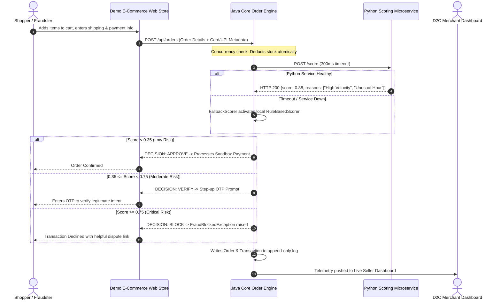

# FraudShield — E-Commerce Architecture, Legal & Security Blueprint
**Course**: Integrated B.Tech 3rd Year Project (E-Commerce & Digital Business)  
**Target Domain**: D2C Risk Intelligence, Checkout Optimization & Anti-Fraud Security

---

## 1. Business Model & Revenue Mechanics

FraudShield operates on a **B2B SaaS hybrid model** combining predictable monthly recurring subscription revenue (MRR) with usage-based volume fees.

### 1.1 Subscription Tiering

| Plan Name | Monthly Fee (INR) | Included Orders / Mo | Overage Per Order | Target Merchant Profile |
| :--- | :---: | :---: | :---: | :--- |
| **Starter** | ₹999 | 1,000 | ₹1.20 | Early-stage D2C, Instagram boutiques, Shopify launchpad |
| **Growth** | ₹3,499 | 5,000 | ₹0.85 | Scaling brands (₹5L–₹25L GMV/mo), high COD volume |
| **Enterprise / Pro** | ₹9,999 | 20,000 | ₹0.50 | Established D2C retailers, custom rule engine, 24/7 SLA |

### 1.2 Unit Economics & Margin Analysis

* **Average Revenue Per Merchant (ARPM)**: ₹3,500 / month.
* **Cost to Serve (COGS)**:
  * Microservice compute + AWS Graviton CPU inference: ₹350 / merchant.
  * File storage & database backups: ₹60 / merchant.
  * Step-up OTP SMS gateway cost (assuming 2% orders step up @ ₹0.20/SMS): ₹20 / merchant.
  * **Total COGS**: ₹430 / merchant / month.
* **Gross Margin**: $\frac{₹3,500 - ₹430}{₹3,500} = \mathbf{87.7\%}$.
* **Break-Even Point**: Fixed baseline cloud overhead of ₹18,000/month $\div$ ₹3,070 net contribution = **6 active merchants**.

---

## 2. Store & Platform Flow Architecture

---

## 3. Payment Integration (Test Mode Sandbox Only)

* **Gateway Strategy**: Implements **Razorpay Sandbox** and **Stripe Test Mode** for zero-risk transaction simulation.
* **Rules of Engagement**:
  * Absolutely **no real financial transactions** or live bank accounts are used.
  * Test Cards: Standard Stripe/Razorpay 3D Secure test card tokens (`4242 4242 4242...`) and simulated UPI Virtual Payment Addresses (e.g., `success@razorpay`).
  * Customer experience preserves complete realism without regulatory exposure.

---

## 4. Digital Logistics & Cash-on-Delivery (COD) Risk Protocol

While FraudShield is delivered as pure cloud software, its primary commercial value for Indian e-commerce lies in **RTO (Return-to-Origin) Prevention on COD Orders**:
1. **The COD Problem**: In India, fake orders placed via Cash-on-Delivery result in the courier delivering to non-existent addresses or customer refusal, leaving the merchant with double shipping costs (₹120–₹200 per return).
2. **FraudShield Courier Integration**:
   * Flagged COD orders with high risk scores trigger an automated WhatsApp confirmation link before order fulfillment.
   * If unconfirmed within 4 hours, the order is placed on hold, protecting the merchant's working capital.

---

## 5. Digital Marketing & Merchant Acquisition Strategy

1. **Top of Funnel (Inbound Lead Magnet)**:
   * **Free Chargeback & RTO Risk Calculator**: An open-source web audit tool where sellers input their monthly orders and courier returns to see immediate projected savings with FraudShield.
2. **Channel Focus**:
   * Direct content marketing on LinkedIn and Twitter targeting D2C founders (*"How we caught a ₹40,000 card-testing attack before the gateway noticed"*).
   * Partnerships with local Shopify development agencies in tier-1 cities (Bengaluru, Mumbai, Delhi-NCR).
3. **Acquisition Budget & CAC**:
   * Initial seed marketing budget: ₹25,000 / month.
   * Projected Customer Acquisition Cost (CAC): ₹1,800 per onboarded merchant.
   * Lifetime Value (LTV) at 10-month average retention: ₹35,000.
   * **LTV / CAC Ratio**: $\mathbf{19.4x}$.

---

## 6. Comprehensive Legal & Security Checklist

| Category | Requirement | Implementation in FraudShield | Compliance Status |
| :--- | :--- | :--- | :---: |
| **Privacy (DPDP Act 2023)** | Explicit User Consent | Transparent privacy checkbox at checkout informing user that telemetry is evaluated for fraud detection. |  Verified |
| **Privacy (DPDP Act 2023)** | Data Minimisation | No storage of names, full addresses, or sensitive personal data; features use anonymized device hashes and distance coordinates. |  Verified |
| **Banking Compliance** | RBI Card Storage Guidelines | Strict zero-card-retention policy. PAN, CVV, and expiry dates are never persisted; only gateway tokens and anonymized PCA components are used. |  Verified |
| **Consumer Protection** | Dark Pattern Prohibition | No pre-ticked consent boxes, no artificial urgency timers ("Only 2 left!"), and clear explanations when an order requires verification. |  Verified |
| **Security Hygiene** | API Key & Secret Management | Merchant API requests require HMAC-SHA256 authenticated headers. Zero hardcoded secrets in version control (`.gitignore` enforced). |  Verified |
| **Integrity** | Fake Review Prevention | Review systems strictly gated behind verified transaction tokens; no unverified guest reviews permitted. |  Verified |
