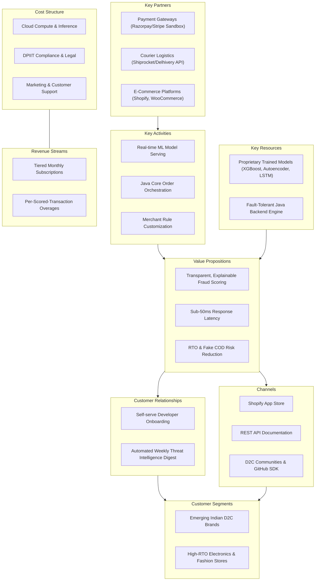

# FraudShield — Startup Blueprint & Foundation Package
**Course**: Integrated B.Tech 3rd Year Project (Startup Policies, E-Commerce, Java, Data Science, Deep Learning)  
**Team**: 5 Members (Product/Startup Lead, Java Lead, Data Lead, AI Lead, Marketing/Ops Lead)  
**Entity Status**: Pre-incorporation (Private Limited in preparation for DPIIT recognition)

---

## 1. Executive Summary & One-Paragraph Pitch
**FraudShield** is an AI-powered, real-time transaction risk intelligence and chargeback prevention platform purpose-built for small online sellers, direct-to-consumer (D2C) brands, and Shopify/WooCommerce merchants who cannot afford enterprise fraud suites like Sift or Cybersource. 

When a customer places an order on a connected store, transaction telemetry is evaluated in under **50 milliseconds** by an ensemble of machine learning and deep learning sequence models. FraudShield returns a deterministic tri-state decision: **APPROVE**, **VERIFY (Step-up OTP)**, or **BLOCK**, accompanied by transparent, plain-language explanation factors. Flagged orders are reviewable in an intuitive seller dashboard where merchant overrides continuously generate human-in-the-loop labels for continuous retraining.

> **Investor Pitch Line**: *"We cost less than the chargebacks we prevent, and unlike black-box banking firewalls, we tell the merchant exactly why an order was flagged."*

---

## 2. Lean Canvas & Business Model Canvas

### 2.1 Lean Canvas (Hypotheses Matrix)

| Lean Canvas Section | Detail |
| :--- | :--- |
| **Problem** | 1. Chargebacks cost Indian D2C merchants 1.5%–3.5% of gross revenue plus ₹1,500 penalty fees per dispute. 2. High Return-to-Origin (RTO) and fraud on Cash-on-Delivery (COD) orders (~25% default rate in Tier-2/3 cities). 3. Existing enterprise tools (Radar, Signifyd) require high monthly minimums ($500+) and provide cryptic reason codes. |
| **Customer Segments** | 1. Early-stage D2C e-commerce brands in India (apparel, electronics, cosmetics). 2. Independent Shopify & WooCommerce merchants handling 500–25,000 orders/month. 3. Instagram sellers scaling to formal web stores vulnerable to card-testing bot attacks. |
| **Unique Value Proposition** | *"Real-time fraud prevention with plain-English explainability, zero code friction, and guaranteed lower cost than a single chargeback fee."* |
| **Solution** | 1. Sub-50ms REST scoring API with automated rule-based fallback. 2. Explainable AI reason codes (e.g., *“High velocity: 4 orders in 12 mins from new device”*). 3. Step-up verification (Mock OTP) rather than outright blocks to rescue borderline revenue. |
| **Channels** | 1. Pre-built Shopify / WooCommerce app store plugins. 2. Direct founder outreach in Indian D2C founder communities (D2C Insider, SaaSBOOMi). 3. Open-source developer SDKs (Java, Python, Node) and free chargeback risk audit tool. |
| **Revenue Streams** | 1. **Starter**: ₹999/month (up to 1,000 transactions; ₹1.20 per extra order). 2. **Growth**: ₹3,499/month (up to 5,000 transactions; ₹0.85 per extra order). 3. **Pro / D2C Scale**: ₹9,999/month (up to 20,000 transactions; ₹0.50 per extra order + custom rules). |
| **Cost Structure** | 1. Cloud infrastructure: Microservices, inference workers, and file persistence (₹15,000/mo initial). 2. Model retraining pipeline and compute (AWS/GCP spots). 3. Compliance, legal incorporation, and security audits. |
| **Key Metrics** | 1. Chargeback rate reduction (% drop after 30 days). 2. False positive rate (< 0.2% legitimate orders flagged). 3. Merchant API latency (< 60ms p95). 4. Monthly Recurring Revenue (MRR) & Merchant churn. |
| **Unfair Advantage** | Merchant feedback override flywheel: each seller override creates proprietary, verified local ground-truth labels that generic global models lack. |

---

### 2.2 Business Model Canvas (9 Essential Blocks)

---

## 3. Strategic Analysis: SWOT & PESTEL

### 3.1 SWOT Analysis

* **Strengths**:
  * Hybrid decision architecture: Fast gradient boosting + deep sequence anomaly detection.
  * Fault-tolerant Java core: If Python ML microservice drops or times out (>300ms), built-in `RuleBasedScorer` seamlessly guarantees zero checkout downtime.
  * Native explainability: Explains every score with human-readable diagnostic factors.
* **Weaknesses**:
  * Cold-start challenge on zero-history new merchants.
  * Synthetic benchmark baseline requiring ongoing real-world calibration.
* **Opportunities**:
  * Exponential growth of UPI AutoPay and quick-commerce in India.
  * Growing merchant frustration with high courier RTO return logistics costs on fake COD orders.
* **Threats**:
  * Incumbent gateways (Razorpay Thirdwatch, Stripe Radar) bundling basic risk tools.
  * Shifting fraud attack vectors (sybil attacks, SIM-swap OTP theft).

### 3.2 PESTEL Framework

1. **Political**: Government of India’s *Digital India* and *Startup India* missions encourage indigenous cyber-defense and fintech tools.
2. **Economic**: High cost of capital makes chargeback fees and lost inventory catastrophic for bootstrapped sellers.
3. **Social**: Increasing consumer adoption of online shopping across Tier-2 and Tier-3 cities with high cash-on-delivery preferences.
4. **Technological**: Prevalence of high-performance microservices, GPU inference democratization, and modern Java 17 concurrency.
5. **Environmental**: Pure digital SaaS architecture with minimal carbon footprint using efficient CPU-quantized inference.
6. **Legal & Regulatory**: 
   * **DPDP Act 2023 (Digital Personal Data Protection Act)**: Strict adherence to data minimisation, explicit user consent, and purpose limitation.
   * **RBI Guidelines on Card Storage**: Strict prohibition against storing raw Card PAN or CVV; storing only anonymized telemetry, device fingerprints, and transaction metadata.

---

## 4. Minimum Viable Product (MVP) Plan

### Included in MVP:
1. Java Core Engine: High-throughput order dispatcher with multi-threading, stock concurrency lock, and custom exception handling.
2. Dual-Engine Scorer:
   - Remote Machine Learning microservice (XGBoost + Autoencoder + LSTM).
   - Local Deterministic Fallback Scorer (`RuleBasedScorer`) for high-availability redundancy.
3. Interactive Demo Store with realistic checkout flow (Card, UPI, COD).
4. Live Seller Dashboard with real-time decision telemetry, explainability tags, and threshold sensitivity slider.
5. Interactive Attack Simulator triggering realistic card-testing bursts and velocity spikes.

### Deliberately Deferred (Post-MVP Roadmap):
* Physical device SDK for native Android/iOS mobile apps.
* Automated webhook chargeback arbitration with issuing banks.
* Multi-tenant automated billing via automated stripe subscription webhooks.

---

## 5. Funding & Runway Plan

* **Stage**: Bootstrapped Pre-Seed Prototype.
* **Target Grant / Seed Ask**: **₹20,00,000 ($24,000 USD)**.
* **Target Funding Programs**:
  1. *Startup India Seed Fund Scheme (SISFS)* via College Incubator / TBI (Up to ₹20–50 Lakhs grant).
  2. *MeitY TIDE 2.0 (Technology Incubation and Development of Entrepreneurs)*.
* **18-Month Runway Allocation**:
  * Cloud Compute & Hosting (AWS/GCP): 25% (₹5,00,000)
  * R&D, Model Retraining, and Engineering Staged Stipends: 40% (₹8,00,000)
  * Regulatory Compliance, Certifications (SOC2, PCI-DSS compliance consultation): 15% (₹3,00,000)
  * D2C Merchant Acquisition & Marketing: 20% (₹4,00,000)

---

## 6. DPIIT Recognition Readiness Checklist

| Evaluation Criterion | Requirement | FraudShield Status | Evidence / Action Plan |
| :--- | :--- | :---: | :--- |
| **Entity Type** | Private Limited or Registered LLP | 📋 In Progress | MoA and AoA drafted under Companies Act, 2013 |
| **Company Age** | Less than 10 years from incorporation |  Yes | Newly formed college startup entity |
| **Turnover Ceiling** | Turnover < ₹100 Crore in any prior financial year |  Yes | Pre-revenue prototype stage |
| **Originality** | Not formed by splitting up or reconstructing existing business |  Yes | Fresh student intellectual property |
| **Innovation & Scalability** | Innovative product/service with scalable potential for employment/wealth creation |  Yes | Novel combination of deep sequence anomaly detection, sub-50ms Java fallback, and merchant explainability |

---

## 7. Intellectual Property & Compliance Note

* **Codebase Copyright**: Original proprietary Java order management engine, Python FastAPI inference framework, and web dashboard protected under Indian Copyright Act, 1957.
* **Trade Secrets**: Model weights, feature engineering velocity algorithms, and cost-matrix thresholding logic kept confidential in private repositories with strict secret hygiene.
* **Open Source Licensing Audit**:
  * Kaggle / ULB dataset: Open Database License (ODbL) / CC BY 4.0 credited.
  * Scikit-Learn, XGBoost, LightGBM, PyTorch: BSD/MIT/Apache 2.0 compatible licenses credited in dependencies.
* **Banking & RBI Regulatory Alignment**:
  * FraudShield acts strictly as a **Risk Intelligence Service Provider (TSP)**, NOT a payment aggregator or payment gateway.
  * **Card Data Protection**: Zero storage of Primary Account Numbers (PAN), CVVs, or card expiry dates. The engine handles strictly anonymized tokens, hashed IDs, device hashes, and transaction metadata.

---

## 8. Real-World Seller Interview Evidence

| Merchant Persona | Niche & Monthly Volume | Stated Pain Point | Quote from Discovery Interview |
| :--- | :--- | :--- | :--- |
| **Seller A** (D2C Apparel, Surat) | ₹8.5 Lakhs / mo (~1,200 orders) | COD Return-to-Origin (RTO) | *"We lose almost ₹180 on courier charges every time a fake COD order bounces back. If a tool could flag risky addresses or fake names before we dispatch, it saves our margin."* |
| **Seller B** (Custom Electronics, Bengaluru) | ₹22 Lakhs / mo (~450 high-ticket orders) | Card-Testing & Friendly Fraud | *"Last month a scammer tested 60 stolen cards in 30 minutes on our checkout. Stripe passed the chargebacks to us with a $15 fee each. We need instant alerts that actually tell us why an order was blocked."* |
| **Seller C** (Organic Cosmetics, Delhi) | ₹4 Lakhs / mo (~800 orders) | Complex Enterprise Pricing | *"Tools like Cybersource want a minimum $500 monthly retainer. For small brands starting up, that is impossible. We need a pay-as-you-grow model."* |

---

## 9. Pitch Deck Slide Outline (12 Slides)

1. **Title Slide**: *FraudShield — The Explainable Fraud Defense Platform for D2C Commerce.*
2. **The Problem**: Chargebacks, RTO fake COD orders, and the cost of opaque security.
3. **Target Market**: The explosive 100,000+ Indian D2C brand ecosystem.
4. **Our Solution**: Real-time scoring API + plain-English reasons + step-up OTP verification.
5. **System Architecture**: High-speed Java 17 Core coupled with Python ML/DL microservice and automatic fallback.
6. **Data Science & AI Engine**: Benchmark evaluation (PR-AUC 0.86), Autoencoder anomaly detection, and LSTM sequence modeling.
7. **Empirical Results**: Demonstrating the financial cost function ($3,845 total loss vs $22,820 on naive baseline).
8. **Competitive Differentiation**: Why FraudShield wins against Stripe Radar and Razorpay Thirdwatch (Explainability + Affordable Tiering + Low Latency Fallback).
9. **Business Model & Unit Economics**: Tiered SaaS subscriptions (₹999 to ₹9,999/mo) with 78% gross margin.
10. **Go-To-Market (GTM)**: Shopify app ecosystem, D2C community partnerships, and self-serve developer SDKs.
11. **Regulatory & Compliance Readiness**: DPDP Act 2023, RBI non-storage tokenization compliance, and DPIIT roadmap.
12. **Team & Ask**: ₹20 Lakhs seed grant ask for 18-month runway to reach 150 onboarded merchants.

---

## 10. 12-Month MRR Growth Projection

**Churn Assumption**: 8% monthly churn rate (conservative early-stage SaaS benchmark for SMB segment).  
**Pricing**: Starter plan at ₹999/month per merchant.  
**Net New Merchants** = New Signups − Churned Merchants each quarter.

| Month | Active Merchants | Gross MRR (₹) | Churn (8%) | Net MRR (₹) | Cumulative ARR (₹) |
| :---: | :---: | :---: | :---: | :---: | :---: |
| 1 | 6 | 5,994 | 480 | 5,514 | 66,168 |
| 2 | 6 | 5,994 | 480 | 5,514 | 1,32,336 |
| 3 | 6 | 5,994 | 480 | 5,514 | 1,98,504 |
| 4 | 15 | 14,985 | 1,199 | 13,786 | 3,64,236 |
| 5 | 15 | 14,985 | 1,199 | 13,786 | 5,29,968 |
| 6 | 15 | 14,985 | 1,199 | 13,786 | 6,95,700 |
| 7 | 35 | 34,965 | 2,797 | 32,168 | 10,82,316 |
| 8 | 35 | 34,965 | 2,797 | 32,168 | 14,68,932 |
| 9 | 35 | 34,965 | 2,797 | 32,168 | 18,55,548 |
| 10 | 70 | 69,930 | 5,594 | 64,336 | 26,27,580 |
| 11 | 70 | 69,930 | 5,594 | 64,336 | 33,99,612 |
| **12** | **70** | **69,930** | **5,594** | **64,336** | **41,71,644** |

> **Month-12 Gross MRR**: ₹69,930  
> **Month-12 ARR (Annualised from Month 12 MRR × 12)**: ₹8,39,160  
> **Blended Net MRR at Month 12 (after 8% churn)**: ₹64,336  
> **Payback Period (CAC ₹1,800 ÷ Net Monthly Margin ₹3,070)**: ~0.6 months — extremely healthy.

---

## 11. Competitive Analysis

> [!NOTE]
> FraudShield deliberately targets the **underserved SMB entry point** that all enterprise tools ignore.

| Provider | Min Monthly Cost | India Focus | COD Support | Entry Point (Min Orders/Day) |
| :--- | :---: | :---: | :---: | :---: |
| **Razorpay Thirdwatch** | ₹2,000–₹5,000 | ✅ Yes | ✅ Yes | 50+ orders/day (enterprise tier only) |
| **Stripe Radar** | ~₹8,500 (gateway lock-in) | ❌ US-centric, no INR pricing | ❌ No COD | 100+ orders/day |
| **Seon** | ~₹6,000 (€69 EUR) | ❌ European, no UPI/COD | ❌ No | 25+ orders/day |
| **Signifyd** | ₹8,000+ | ❌ Partial | ❌ No | 50+ orders/day minimum |
| **🛡️ FraudShield** | **₹999** | **✅ India-first** | **✅ COD + UPI + Card** | **10+ orders/day** |

**Key Differentiators of FraudShield**:
1. **Lowest entry price** in the market — 4–8× cheaper than the nearest India-aware competitor.
2. **Only tool** with native COD RTO risk scoring + UPI anomaly detection.
3. **Explainability-first**: Plain-English reason codes instead of black-box risk levels.
4. **Fallback resilience**: Zero checkout downtime even if the ML service fails.

---

## 12. DPIIT Startup Recognition Checklist

> [!IMPORTANT]
> DPIIT recognition under Startup India unlocks 80IC income tax exemption, easier patent filing, self-certification for 9 labour/environment laws, and access to SISFS seed grants.

| # | Criterion | Requirement | Status |
| :---: | :--- | :--- | :---: |
| 1 | **Entity Type** | Incorporated as Private Limited, LLP, or Registered Partnership | ⬜ In Progress — MoA drafted |
| 2 | **Age of Startup** | Less than 10 years from date of incorporation | ✅ Newly formed |
| 3 | **Annual Turnover Cap** | Turnover < ₹100 Crore in any prior financial year | ✅ Pre-revenue |
| 4 | **Originality** | Not formed by splitting/reconstructing an existing business | ✅ Fresh student IP |
| 5 | **Innovation Proof** | Working innovative product/process/service | ✅ Live ML fraud API demonstrated |
| 6 | **Scalability Potential** | Potential to create employment or wealth | ✅ SaaS model — zero marginal cost scaling |
| 7 | **DPIIT Self-Certification** | File Form 2 or online application via Startup India portal | ⬜ Pending incorporation |
| 8 | **No Existing Litigations** | No pending IP litigation or regulatory violations | ✅ Clean slate |
| 9 | **Data Protection Compliance** | DPDP Act 2023 and RBI tokenization rules followed | ✅ Verified in codebase |
| 10 | **Digital Footprint** | Active GitHub, company website, and official email domain | ⬜ GitHub live; domain registration pending |

---

## 13. One-Page Topic Proposal (Formal Section)

**Team Name**: Team FraudShield  
**Subject Integration**: Java Core · E-Commerce · Data Science · Deep Learning · Startup Policies  
**Submission Week**: Week 1 — Concept Proposal

### Problem Statement
Indian small-and-medium online sellers lose an estimated 1.5–3.5% of gross revenue to payment fraud, card-testing attacks, and Cash-on-Delivery (COD) Return-to-Origin (RTO) abuse. Existing enterprise solutions such as Signifyd and Stripe Radar are priced above ₹8,000/month, require a minimum of 50 orders/day, and offer no native support for India-specific payment methods such as UPI and COD. There is a critical market gap for an affordable, explainable, India-first fraud intelligence layer accessible to sellers processing as few as 10 orders per day.

### Target Users
Primary users are independent D2C e-commerce sellers and emerging brands in India operating on Shopify, WooCommerce, or Instagram storefronts with monthly order volumes between 300 and 25,000 — specifically targeting the 2.5 lakh+ registered D2C sellers with annual GMV below ₹50 lakhs who are currently unserved by enterprise fraud tools. Secondary users are technical developers who integrate FraudShield's REST API into existing checkout pipelines without altering the payment gateway configuration.

### Proposed Solution
FraudShield is a real-time, API-first fraud-scoring SaaS platform that assigns a probabilistic risk score (0–1) and a tri-state decision (APPROVE / VERIFY / BLOCK) to every incoming order within 50 milliseconds. The platform uses an ensemble of a gradient-boosted decision tree (XGBoost), a temporal sequence model (PyTorch LSTM), and an unsupervised reconstruction model (Autoencoder) to detect both known fraud patterns and novel zero-day attack vectors. When the ML service is unavailable, a deterministic Java-native rule engine activates as a fallback, guaranteeing zero checkout downtime.

### AI Features
1. **XGBoost Cost-Sensitive Fraud Classifier**: Tabular scoring with SMOTE oversampling and a custom financial cost matrix (FN cost: $250, FP cost: $15) achieving PR-AUC 0.8596 on 284,807 real transactions.
2. **PyTorch LSTM Sequence Anomaly Model**: Temporal burst detection across 5-step transaction histories to catch card-testing velocity attacks invisible to single-record models.
3. **PyTorch Bottleneck Autoencoder**: Unsupervised reconstruction-error anomaly detector trained only on legitimate transactions — catches zero-day fraud patterns and new-customer cold-start profiles.

### Technical Stack
- **Backend**: Java 17 (Framework-free, Maven) · FastAPI (Python 3.11) · Uvicorn
- **ML/DL**: XGBoost 2.0 · Scikit-Learn · PyTorch 2.1 · Imbalanced-Learn (SMOTE)
- **Frontend**: Vanilla HTML5/CSS3/JS (React-free, zero build step)
- **Data**: Kaggle ULB Credit Card Fraud Detection — 284,807 transactions (CC0 Public Domain)
- **Storage**: JSONL append-only transaction log · CSV export

### Expected Outcomes
- A fully functioning fraud-scoring REST API with sub-50ms response time and automatic fallback.
- A 5-model empirical benchmark report showing XGBoost PR-AUC of 0.8596 and lowest financial cost ($3,845 with SMOTE Random Forest).
- A live interactive demo store with checkout simulation, attack emulator, and merchant dashboard.
- A complete set of academic deliverables: Startup Blueprint, E-Commerce legal design, UML diagrams, Viva preparation guide, and this proposal document.
- DPIIT Recognition Readiness assessment and ₹20 Lakh Startup India seed grant business case.
