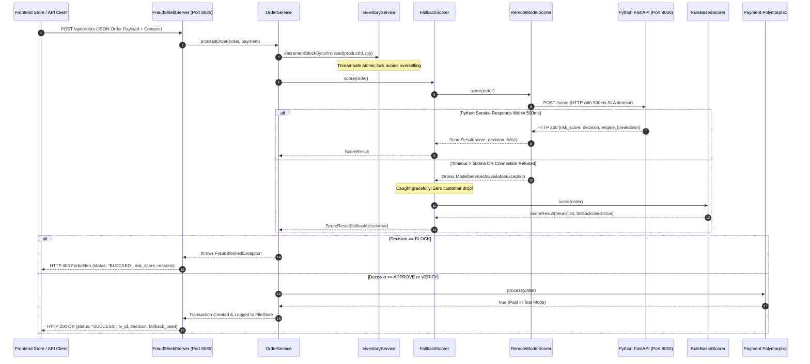

# FraudShield — UML Class & System Architecture Diagrams
**Course**: Integrated B.Tech 3rd Year Project (Java Core & System Design)  
**Standard**: UML 2.5 Object-Oriented Specification

---

## 1. Class Design Diagram (Core Domain, Interfaces, & Polymorphism)

```mermaid
classDiagram
    direction TB

    %% Domain Entities
    class Customer {
        -String id
        -String email
        -String hashedPhone
        -double homeLatitude
        -double homeLongitude
        +getId() String
        +getEmail() String
    }

    class Merchant {
        -String id
        -String name
        -String category
        -String apiKey
        -double riskThresholdBlock
        -double riskThresholdVerify
        +setThresholds(double, double) void
    }

    class Product {
        -String id
        -String name
        -double price
        -int stock
        +getStock() int
        +setStock(int) void
    }

    class OrderItem {
        -String productId
        -int quantity
        -double unitPrice
        +getSubtotal() double
    }

    class Order {
        -String id
        -String merchantId
        -String customerId
        -List~OrderItem~ items
        -double totalAmount
        -String ipAddress
        -String deviceFingerprint
        -double shippingLatitude
        -double shippingLongitude
        -Instant createdAt
        -String status
        +getTotalAmount() double
        +setStatus(String) void
    }

    class Transaction {
        -String id
        -String orderId
        -String merchantId
        -String paymentMethod
        -double amount
        -double riskScore
        -Decision decision
        -List~String~ reasons
        -boolean fallbackUsed
        -Instant timestamp
    }

    %% Enumeration & Result
    class Decision {
        <<enumeration>>
        APPROVE
        VERIFY
        BLOCK
    }

    class ScoreResult {
        -double riskScore
        -Decision decision
        -List~String~ reasons
        -boolean fallbackUsed
        +getRiskScore() double
        +getDecision() Decision
        +isFallbackUsed() boolean
    }

    %% Payment Hierarchy (Inheritance & Polymorphism)
    class Payment {
        <<abstract>>
        -String paymentId
        -String method
        +process(Order)* boolean
    }

    class CardPayment {
        -String cardToken
        -String last4
        +process(Order) boolean
    }

    class UpiPayment {
        -String vpa
        +process(Order) boolean
    }

    class CodPayment {
        -String confirmationPhone
        +process(Order) boolean
    }

    Payment <|-- CardPayment
    Payment <|-- UpiPayment
    Payment <|-- CodPayment

    %% Fraud Scorer Hierarchy (Interfaces & Composition)
    class FraudScorer {
        <<interface>>
        +score(Order)* ScoreResult
    }

    class RemoteModelScorer {
        -String serviceUrl
        -HttpClient httpClient
        +score(Order) ScoreResult
    }

    class RuleBasedScorer {
        +score(Order) ScoreResult
    }

    class FallbackScorer {
        -FraudScorer remoteScorer
        -FraudScorer ruleBasedScorer
        -boolean lastCallUsedFallback
        +score(Order) ScoreResult
        +isLastCallUsedFallback() boolean
    }

    FraudScorer <|.. RemoteModelScorer
    FraudScorer <|.. RuleBasedScorer
    FraudScorer <|.. FallbackScorer
    FallbackScorer o-- RemoteModelScorer : wraps
    FallbackScorer o-- RuleBasedScorer : fallback

    %% Custom Exceptions Hierarchy
    class Exception {
        <<built-in>>
    }
    class ScoringException {
        +ScoringException(String)
    }
    class ModelServiceUnavailableException {
        +ModelServiceUnavailableException(String)
    }
    class InvalidInputException
    class OutOfStockException
    class PaymentFailedException
    class FraudBlockedException

    Exception <|-- ScoringException
    ScoringException <|-- ModelServiceUnavailableException
    Exception <|-- InvalidInputException
    Exception <|-- OutOfStockException
    Exception <|-- PaymentFailedException
    Exception <|-- FraudBlockedException

    %% Services & Orchestration
    class InventoryService {
        -ConcurrentHashMap~String, Product~ products
        +decrementStockSynchronized(String, int) boolean
        +decrementStockUnsynchronized(String, int) boolean
    }

    class PaymentService {
        +executePayment(Order, Payment) boolean
    }

    class FileStore {
        -String logFilePath
        -String exportCsvPath
        -ReentrantLock fileLock
        +saveTransaction(Order, Transaction) void
    }

    class OrderService {
        -BlockingQueue~Order~ orderQueue
        -ExecutorService workerPool
        -ScheduledExecutorService backgroundScheduler
        -InventoryService inventoryService
        -PaymentService paymentService
        -FraudScorer fraudScorer
        -FileStore fileStore
        +processOrder(Order, Payment) Transaction
    }

    OrderService --> InventoryService
    OrderService --> PaymentService
    OrderService --> FraudScorer
    OrderService --> FileStore
    Order "1" *-- "many" OrderItem
    Order --> Customer
    Order --> Merchant
    Transaction --> Decision
    ScoreResult --> Decision
```

---

## 2. Sequence Diagram (Multi-Engine Scoring & Fallback Resilience)

